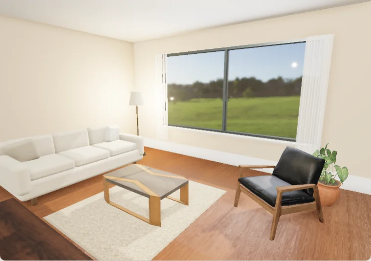

# 好好装 · 3D 家居设计工作台

装修开工前，先把家具摆进房间。好好装把户型、陈设清单和可编辑的 3D 空间放在一起，方便你比较布局、核对家具尺寸和试换材质。

[打开示例户型，开始试装](https://clara-kyp.github.io/haohaozhuang/)

## 装修前先看清什么

- **空间够不够用**。对照户型看看玄关能否留出收纳位置，客厅摆下沙发后从哪里走。
- **家具和材质搭不搭**。把沙发、茶几、墙面和地板放在同一个 3D 房间里看，再决定怎么配。

## 核心功能

- **核对户型与布局**。上传户型图识别房间，按实测校准尺寸。可以保留原布局，也可以比较优先改善动线或增加收纳的方案。
- **生成陈设清单**。输入居住需求和风格，最多添加 3 张风格参考图。提案列出家具尺寸、摆放位置和搭配理由，确认前可先看平面预览。
- **在 3D 里试装**。逐件移动、旋转或替换家具，试换墙面、地板和吊顶。保存草稿后，可以从上次编辑的房间继续。

## 快速开始

1. 打开在线版，选择「两室一厅 · 竖厅」或「带前后院 · 小户型」，点击「试用示例户型」。
2. 选中想布置的房间，点击「确认户型，规划陈设」，再点「查看内置陈设示例」。
3. 核对清单后，点击「确认清单，布置到3D空间」，试着挪一挪家具、换一换地板。

**用自己的户型图**。在首页展开「有邀请码？启用在线 AI」。输入邀请码后，即可上传户型图、生成布局和陈设。

**本地版**。把看中的商品通过链接或 Excel 清单加入储物栏，核对款式和尺寸后放进房间试摆。也可以用 Blender 为房间或单件物品烘焙 2K 贴图。

## 试装示例

选「两室一厅 · 竖厅」的客厅。先在清单里看沙发和茶几的尺寸，确认后切换到俯视视角检查摆放，再回到室内视角试换地板。



<details>
<summary>演示资料</summary>

[观看 1 分钟介绍](https://clara-kyp.github.io/haohaozhuang/showcase/haohaozhuang.mp4) · [下载路演 PPT](https://clara-kyp.github.io/haohaozhuang/showcase/haohaozhuang.pptx)

</details>

<details>
<summary>开发与部署</summary>

### 本地启动

后端依赖见 [backend/requirements.txt](backend/requirements.txt)。在 `app` 目录安装前端依赖，模型配置参考 [.env.example](.env.example)。

```bash
npm --prefix app install
.venv/bin/python scripts/start_local.py
```

启动器运行 API 和前端，日志位于 `.runtime/logs/`。启动后访问 [本地工作台](http://127.0.0.1:5173/)。

处理商品动态页时，用 `.venv/bin/python -m playwright install chromium` 安装商品浏览器。商品素材和登录会话分别存放在 `.runtime/products` 下的对应目录。房间和商品烘焙使用 `BLENDER_BIN` 指向的 Blender。

### 云端 AI

1. 在 Render 导入 [render.yaml](render.yaml)，填写 `MINIMAX_API_KEY`。服务生成的 `HAOHAO_ACCESS_CODE` 可用于邀请试用者。
2. 将服务的 HTTPS 地址填入 GitHub Actions 变量 `AI_API_ORIGIN`，运行 **Deploy GitHub Pages**。
3. 需要添加更多邀请码时，在 Render 的 `HAOHAO_INVITE_HASHES` 中填写邀请码的 SHA-256 十六进制摘要，以空格分隔。

### 文件结构

```text
app/         React 与 Three.js 前端
backend/     FastAPI、AI 规划、商品和烘焙接口
scripts/     本地启动、模型处理与 Blender 脚本
render.yaml  云端 AI 部署配置
```

运行 `npm --prefix app test`、`.venv/bin/python -m unittest discover -s backend/tests` 和 `npm --prefix app run build` 验证项目。模型与贴图来源参见 [模型清单](app/public/models/sources.json) 和 [贴图清单](app/public/textures/sources.json)。

户型图用于前期布局比较。开工前，按现场实测核对尺寸、门窗和结构。草稿保存在浏览器中，使用原浏览器和网址可继续编辑。

[产品需求](PRD.md) · [页面路由](ROUTING.md) · [模型提示词](PROMPTS.md) · [更新记录](https://github.com/Clara-Kyp/haohaozhuang/commits/main/)

</details>
